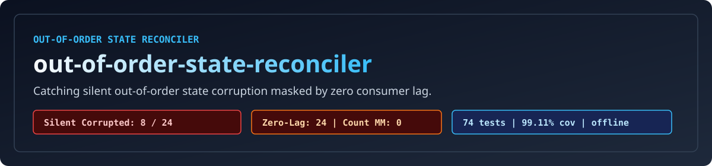
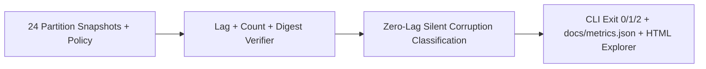
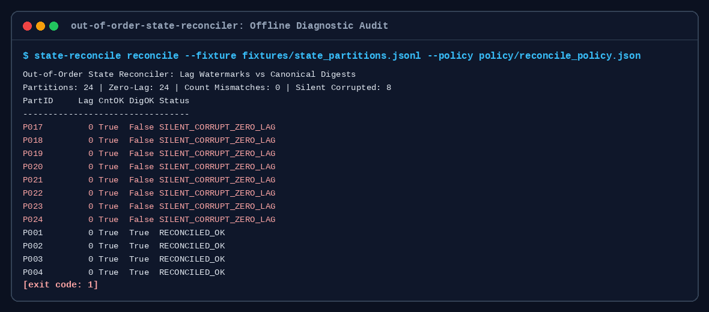

<div align="center">



[](https://github.com/htiwnah/out-of-order-state-reconciler/actions/workflows/ci.yml)
[](https://www.python.org/)
[](LICENSE)

**Deterministic pipeline state reconciler catching silent out-of-order corruption masked by zero consumer lag.**

</div>

## The Structural Impossibility

Storing the highest applied offset cannot detect out-of-order event loss or partial retries, so lag reads zero and row counts match while downstream state is silently corrupted.

Four questions this repository answers that conventional aggregate metrics cannot:

1. How many partitions report `lag = 0` and matching row counts while holding stale state digests?
2. How do we separate zero-lag silent corruption from ordinary lagged replication?
3. Why do watermark and row-count monitors both give false green signals on out-of-order overwrites?
4. What is the exact `1 / N` resolution floor of a 24-partition reconciliation run?

## The Uncomfortable Numbers

* **Watermark and row-count checks look 100% green while one-third of shards are corrupted:** Across `24 evaluated partitions`, all `24 zero-lag partitions` show `0 count mismatches`, yet **`8 silent corrupted partitions`** hold stale digests (`16 clean partitions`).
* **Resolution floor:** On 24 shards, the `4.17% resolution floor` (`1 / 24`) bounds single-partition precision.

Credibility receipt: **`74 tests`** passing with **`99.11% line coverage`**, zero broker dependencies, verified across Python 3.10, 3.11, and 3.12 in CI.

## Quickstart

Prerequisites: Python 3.10+ (zero API keys, zero cloud credentials, zero network calls required).

```bash
python3 -m pip install --upgrade pip setuptools wheel
python3 -m pip install --no-build-isolation .
state-reconcile reconcile --fixture fixtures/state_partitions.jsonl --policy policy/reconcile_policy.json
make verify
```

Containerized one-command reproduction:

```bash
docker build -t out-of-order-state-reconciler .
docker run --rm out-of-order-state-reconciler reconcile --fixture fixtures/state_partitions.jsonl --policy policy/reconcile_policy.json
```

## Claim 1: Zero Consumer Lag and Matching Row Counts Cannot Prove State Integrity

When an older event overwrites a newer record out of order, row counts stay equal (`1,000`) and high-water offset advances cleanly (`lag = 0`).

| Check Type | Shards Flagged | Silent Corruptions Missed |
| :--- | ---: | ---: |
| Consumer lag check (`lag > 0`) | `0` | `8` |
| Row-count parity check | `0 count mismatches` | `8` |
| **out-of-order-state-reconciler** (canonical digest) | **`8 silent corrupted partitions`** | **`0`** |

**What this buys vs. what it costs:** Canonical state digest verification catches every out-of-order overwrite deterministically, at the cost of computing per-partition digests during snapshots.

## Claim 2: Zero-Lag Silent Corruption vs Lagged Mismatch Classification

Separating `SILENT_CORRUPT_ZERO_LAG` from `STATE_MISMATCH_LAGGED` prevents paging on-call engineers for routine replication catch-up.

| Partition State | Lag | Count OK | Digest OK | Verdict |
| :--- | ---: | :--- | :--- | :--- |
| Clean synced (`P001`-`P016`) | `0` | `True` | `True` | `RECONCILED_OK` |
| Out-of-order overwrite (`P017`-`P024`) | `0` | `True` | `False` | `SILENT_CORRUPT_ZERO_LAG` |
| Active catch-up lag | `> 0` | `False` | `False` | `STATE_MISMATCH_LAGGED` |

## Claim 3: Exact Partition Coverage Across 24 Shards

16 shards reconcile cleanly while 8 zero-lag shards diverge on digest equality:

| Category | Partitions | Share |
| :--- | ---: | ---: |
| Clean reconciled | `16 clean partitions` | `66.67%` |
| Silent zero-lag corruption | `8 silent corrupted partitions` | `33.33%` |

## Bugs the Measurement Found (War Stories)

1. **Null digest fields coerced to literal `'None'` (`ADR-004`):** Normalizing `None` digests to `""` prevented false equality between missing metadata fields.
2. **Python 3.12 CI build isolation missing `setuptools` (`ADR-003`):** Installing `pip setuptools wheel` before `--no-build-isolation .` fixed Python 3.12 runner builds.

## Architecture Diagram




## Evidence

Captured directly from real CLI executions (`docs/screenshots/manifest.json` and `docs/video/manifest.json` record every command and exit code):


Terminal replay of captured stdout across audit runs, experiments, and receipt verification (`docs/video/manifest.json`):



## The Awkward Corpus

* `fixtures/state_partitions.jsonl` models `24 evaluated partitions` all at `lag = 0` and `1,000` rows, with `P017`-`P024` carrying stale out-of-order digests.

## What This Cannot Measure

* **Unlogged upstream event drops:** Digest checks detect divergence against expected snapshots, not events lost before entering the source log (`ADR-005`).

## Layout, Exit Codes, and Reproduction

```text
out-of-order-state-reconciler/
├── src/out_of_order_state_reconciler/  # config, reconciler, cli
├── policy/reconcile_policy.json
├── fixtures/state_partitions.jsonl
├── sql/state_reconcile.sql
├── experiments/run_experiments.py
├── tests/  # 74 property and parametric tests
└── docs/   # banner.svg, architecture.svg, index.html, ADRs, receipts
```

### CLI Exit Codes

* `0`: Zero-lag silent corruptions are within budget.
* `1`: Tool answered cleanly ("no"): silent zero-lag corruptions exceeded budget.
* `2`: Missing file, malformed JSON, or invalid flags.

### Make Targets

* `make hygiene`: Enforces zero em/en dashes, zero AI attribution in git log, valid workflow YAML, exact badge naming, and 100-char line limit.
* `make test`: Runs all `74 tests`.
* `make receipts`: Re-runs experiments and tests, updates `docs/metrics.json`, and runs `tools/check_numbers.py` (matching anchor phrases so stale surrounding prose fails CI).
* `make verify`: Executes `hygiene`, `lint`, `test`, and `receipts` end-to-end offline.

## Tech Stack and ADRs

| Component | Role | Why Chosen Here |
| :--- | :--- | :--- |
| Python 3.10+ stdlib | Digest reconciliation, CLI | Zero runtime dependencies (`ADR-003`) |
| SQL (`sql/state_reconcile.sql`) | Partition verdict schema | Maps directly to data-quality tables |
| Multi-stage `Dockerfile` + `Makefile` | Portable offline verification | One-command local & CI parity |
| GitHub Actions (3.10 / 3.11 / 3.12) | Matrix lint, tests, >=95% cov, receipts | Re-measures every figure |

* [ADR-001: Compare Canonical Digests Even When Lag Reads Zero](docs/adr/ADR-001-digest-under-zero-lag.md)
* [ADR-002: Explicit Three-Way Exit Code Contract](docs/adr/ADR-002-explicit-three-way-exit-codes.md)
* [ADR-003: Stdlib Core and Python 3.12 Build Isolation](docs/adr/ADR-003-stdlib-core-and-python312-ci.md)
* [ADR-004: Separate Row-Count Mismatches From Digest Mismatches](docs/adr/ADR-004-separate-count-and-digest.md)
* [ADR-005: Snapshot Reconciliation Boundaries and Resolution Floor](docs/adr/ADR-005-snapshot-boundaries.md)

## The Pivot and Future Work

Live Kafka consumer group offset polling is intentionally out of scope. **Trigger condition to build it:** when Airflow/PySpark nightly jobs export partition manifests and teams want automated backfill triggers on digest divergence.

Future v2 milestones:
* Add Merkle-tree sub-range diffing to pinpoint exact corrupted key ranges.
* Support Parquet/Delta Lake snapshot manifest adapters.
* Track **silent zero-lag corruption count** per ETL release.
